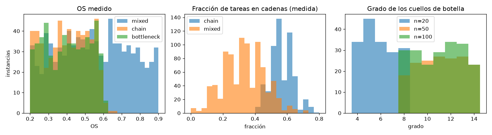

# F2B · Validación del generador de instancias

Generado automáticamente por `python -m salbp_selector.gen.validate` el 2026-11-26 02:12. Semilla maestra 20261116; 100 instancias por celda del núcleo; 2000 de la capa ampliada; tiempo total 29 s.

## Resumen de criterios

| Criterio | Resultado |
|---|---|
| 1. Cumplimiento de celda (100 %) | CUMPLE (mínimo 100.0 %) |
| Tasa de rechazo < 50 % en n = 50 y 100 | CUMPLE (máximo 11.5 %) |
| 2. Parecido estructural con el conjunto público | PENDIENTE (falta el conjunto público) |
| 3. Parecido en desempeño con el conjunto público | PENDIENTE (falta el conjunto público) |
| 4. Discriminación entre reglas | 1 celdas con empate total > 90 % |
| 5. Cobertura de la capa ampliada | 0 medidas con huecos |
| 6. Reproducibilidad | CUMPLE (SHA-256 `4f49d616634cd18a…`) |

## 1. Cumplimiento de celda y tasa de rechazo

Comprobación independiente: se recalculan OS, cadenas y cuellos de botella desde los arcos, se valida la instancia (`validate_instance`) y se comprueba que los tiempos estén en [0,02c; c].

| cell | n | structure | os_target | time_dist | instances | compliance_pct | os_mean | os_min | os_max | chain_share_mean | n_bn_mean | rejection_rate | ms_per_instance |
|---|---|---|---|---|---|---|---|---|---|---|---|---|---|
| n20-os02-mix-pb | 20 | mixed | 0.200 | pb | 100 | 100.000 | 0.206 | 0.200 | 0.237 | 0.139 | 0.010 | 0.000 | 0.491 |
| n20-os02-mix-bm | 20 | mixed | 0.200 | bm | 100 | 100.000 | 0.208 | 0.200 | 0.237 | 0.156 | 0.050 | 0.000 | 0.490 |
| n20-os02-mix-pm | 20 | mixed | 0.200 | pm | 100 | 100.000 | 0.208 | 0.200 | 0.263 | 0.156 | 0.110 | 0.000 | 0.490 |
| n20-os06-mix-pb | 20 | mixed | 0.600 | pb | 100 | 100.000 | 0.607 | 0.600 | 0.647 | 0.009 | 0.210 | 0.000 | 0.582 |
| n20-os06-mix-bm | 20 | mixed | 0.600 | bm | 100 | 100.000 | 0.608 | 0.600 | 0.642 | 0.006 | 0.280 | 0.000 | 0.569 |
| n20-os06-mix-pm | 20 | mixed | 0.600 | pm | 100 | 100.000 | 0.607 | 0.600 | 0.637 | 0.009 | 0.140 | 0.000 | 0.584 |
| n20-os09-mix-pb | 20 | mixed | 0.900 | pb | 100 | 100.000 | 0.903 | 0.879 | 0.942 | 0.077 | 0.700 | 0.000 | 0.611 |
| n20-os09-mix-bm | 20 | mixed | 0.900 | bm | 100 | 100.000 | 0.902 | 0.863 | 0.916 | 0.085 | 0.810 | 0.000 | 0.618 |
| n20-os09-mix-pm | 20 | mixed | 0.900 | pm | 100 | 100.000 | 0.903 | 0.868 | 0.937 | 0.101 | 0.900 | 0.000 | 0.596 |
| n20-os02-ch-pb | 20 | chain | 0.200 | pb | 100 | 100.000 | 0.206 | 0.200 | 0.242 | 0.458 | 0.070 | 0.000 | 0.490 |
| n20-os02-ch-bm | 20 | chain | 0.200 | bm | 100 | 100.000 | 0.205 | 0.200 | 0.247 | 0.443 | 0.020 | 0.000 | 0.516 |
| n20-os02-ch-pm | 20 | chain | 0.200 | pm | 100 | 100.000 | 0.204 | 0.200 | 0.221 | 0.457 | 0.040 | 0.000 | 0.503 |
| n20-os06-ch-pb | 20 | chain | 0.600 | pb | 100 | 100.000 | 0.602 | 0.516 | 0.679 | 0.433 | 0.460 | 0.020 | 0.584 |
| n20-os06-ch-bm | 20 | chain | 0.600 | bm | 100 | 100.000 | 0.598 | 0.505 | 0.679 | 0.452 | 0.360 | 0.020 | 0.575 |
| n20-os06-ch-pm | 20 | chain | 0.600 | pm | 100 | 100.000 | 0.593 | 0.500 | 0.668 | 0.435 | 0.310 | 0.029 | 0.576 |
| n20-os02-bn-pb | 20 | bottleneck | 0.200 | pb | 100 | 100.000 | 0.208 | 0.200 | 0.295 | 0.053 | 1.000 | 0.000 | 0.496 |
| n20-os02-bn-bm | 20 | bottleneck | 0.200 | bm | 100 | 100.000 | 0.205 | 0.200 | 0.253 | 0.063 | 1.020 | 0.010 | 0.503 |
| n20-os02-bn-pm | 20 | bottleneck | 0.200 | pm | 100 | 100.000 | 0.207 | 0.200 | 0.247 | 0.077 | 1.000 | 0.000 | 0.491 |
| n20-os06-bn-pb | 20 | bottleneck | 0.600 | pb | 100 | 100.000 | 0.596 | 0.505 | 0.621 | 0.000 | 1.000 | 0.000 | 0.778 |
| n20-os06-bn-bm | 20 | bottleneck | 0.600 | bm | 100 | 100.000 | 0.599 | 0.521 | 0.626 | 0.000 | 1.000 | 0.000 | 0.655 |
| n20-os06-bn-pm | 20 | bottleneck | 0.600 | pm | 100 | 100.000 | 0.593 | 0.500 | 0.626 | 0.000 | 1.000 | 0.038 | 0.652 |
| n50-os02-mix-pb | 50 | mixed | 0.200 | pb | 100 | 100.000 | 0.202 | 0.200 | 0.205 | 0.271 | 0.210 | 0.115 | 0.980 |
| n50-os02-mix-bm | 50 | mixed | 0.200 | bm | 100 | 100.000 | 0.202 | 0.200 | 0.205 | 0.256 | 0.150 | 0.074 | 0.968 |
| n50-os02-mix-pm | 50 | mixed | 0.200 | pm | 100 | 100.000 | 0.202 | 0.200 | 0.205 | 0.259 | 0.120 | 0.099 | 0.960 |
| n50-os06-mix-pb | 50 | mixed | 0.600 | pb | 100 | 100.000 | 0.602 | 0.600 | 0.605 | 0.006 | 0.270 | 0.000 | 1.365 |
| n50-os06-mix-bm | 50 | mixed | 0.600 | bm | 100 | 100.000 | 0.602 | 0.600 | 0.605 | 0.008 | 0.230 | 0.000 | 1.370 |
| n50-os06-mix-pm | 50 | mixed | 0.600 | pm | 100 | 100.000 | 0.602 | 0.600 | 0.605 | 0.008 | 0.310 | 0.000 | 1.355 |
| n50-os09-mix-pb | 50 | mixed | 0.900 | pb | 100 | 100.000 | 0.902 | 0.900 | 0.904 | 0.120 | 1.430 | 0.000 | 1.394 |
| n50-os09-mix-bm | 50 | mixed | 0.900 | bm | 100 | 100.000 | 0.902 | 0.900 | 0.904 | 0.129 | 1.450 | 0.000 | 1.403 |
| n50-os09-mix-pm | 50 | mixed | 0.900 | pm | 100 | 100.000 | 0.902 | 0.900 | 0.904 | 0.129 | 1.380 | 0.000 | 1.402 |
| n50-os02-ch-pb | 50 | chain | 0.200 | pb | 100 | 100.000 | 0.202 | 0.200 | 0.205 | 0.523 | 0.150 | 0.048 | 0.966 |
| n50-os02-ch-bm | 50 | chain | 0.200 | bm | 100 | 100.000 | 0.202 | 0.200 | 0.205 | 0.513 | 0.140 | 0.099 | 1.017 |
| n50-os02-ch-pm | 50 | chain | 0.200 | pm | 100 | 100.000 | 0.202 | 0.200 | 0.205 | 0.524 | 0.140 | 0.038 | 0.982 |
| n50-os06-ch-pb | 50 | chain | 0.600 | pb | 100 | 100.000 | 0.602 | 0.600 | 0.605 | 0.449 | 0.670 | 0.010 | 1.239 |
| n50-os06-ch-bm | 50 | chain | 0.600 | bm | 100 | 100.000 | 0.602 | 0.600 | 0.605 | 0.448 | 0.540 | 0.010 | 1.234 |
| n50-os06-ch-pm | 50 | chain | 0.600 | pm | 100 | 100.000 | 0.602 | 0.600 | 0.605 | 0.439 | 0.740 | 0.010 | 1.262 |
| n50-os02-bn-pb | 50 | bottleneck | 0.200 | pb | 100 | 100.000 | 0.201 | 0.200 | 0.205 | 0.013 | 1.810 | 0.020 | 1.077 |
| n50-os02-bn-bm | 50 | bottleneck | 0.200 | bm | 100 | 100.000 | 0.201 | 0.196 | 0.205 | 0.012 | 2.060 | 0.020 | 1.079 |
| n50-os02-bn-pm | 50 | bottleneck | 0.200 | pm | 100 | 100.000 | 0.202 | 0.200 | 0.205 | 0.013 | 1.930 | 0.020 | 1.095 |
| n50-os06-bn-pb | 50 | bottleneck | 0.600 | pb | 100 | 100.000 | 0.601 | 0.600 | 0.605 | 0.010 | 2.270 | 0.010 | 1.568 |
| n50-os06-bn-bm | 50 | bottleneck | 0.600 | bm | 100 | 100.000 | 0.602 | 0.600 | 0.605 | 0.009 | 2.220 | 0.048 | 1.446 |
| n50-os06-bn-pm | 50 | bottleneck | 0.600 | pm | 100 | 100.000 | 0.601 | 0.600 | 0.605 | 0.006 | 2.000 | 0.038 | 1.428 |
| n100-os02-mix-pb | 100 | mixed | 0.200 | pb | 100 | 100.000 | 0.201 | 0.200 | 0.205 | 0.286 | 0.420 | 0.020 | 2.004 |
| n100-os02-mix-bm | 100 | mixed | 0.200 | bm | 100 | 100.000 | 0.201 | 0.200 | 0.205 | 0.279 | 0.220 | 0.020 | 2.170 |
| n100-os02-mix-pm | 100 | mixed | 0.200 | pm | 100 | 100.000 | 0.202 | 0.200 | 0.205 | 0.290 | 0.280 | 0.010 | 1.953 |
| n100-os06-mix-pb | 100 | mixed | 0.600 | pb | 100 | 100.000 | 0.602 | 0.600 | 0.604 | 0.009 | 0.360 | 0.000 | 3.428 |
| n100-os06-mix-bm | 100 | mixed | 0.600 | bm | 100 | 100.000 | 0.602 | 0.600 | 0.605 | 0.006 | 0.410 | 0.000 | 3.276 |
| n100-os06-mix-pm | 100 | mixed | 0.600 | pm | 100 | 100.000 | 0.601 | 0.600 | 0.604 | 0.007 | 0.360 | 0.000 | 3.265 |
| n100-os09-mix-pb | 100 | mixed | 0.900 | pb | 100 | 100.000 | 0.900 | 0.900 | 0.901 | 0.000 | 0.060 | 0.000 | 10.798 |
| n100-os09-mix-bm | 100 | mixed | 0.900 | bm | 100 | 100.000 | 0.900 | 0.900 | 0.901 | 0.000 | 0.150 | 0.000 | 10.729 |
| n100-os09-mix-pm | 100 | mixed | 0.900 | pm | 100 | 100.000 | 0.900 | 0.900 | 0.900 | 0.000 | 0.070 | 0.000 | 10.764 |
| n100-os02-ch-pb | 100 | chain | 0.200 | pb | 100 | 100.000 | 0.202 | 0.200 | 0.205 | 0.532 | 0.350 | 0.020 | 1.980 |
| n100-os02-ch-bm | 100 | chain | 0.200 | bm | 100 | 100.000 | 0.202 | 0.200 | 0.205 | 0.530 | 0.310 | 0.010 | 2.215 |
| n100-os02-ch-pm | 100 | chain | 0.200 | pm | 100 | 100.000 | 0.202 | 0.200 | 0.205 | 0.532 | 0.300 | 0.000 | 1.957 |
| n100-os06-ch-pb | 100 | chain | 0.600 | pb | 100 | 100.000 | 0.602 | 0.600 | 0.605 | 0.448 | 1.140 | 0.000 | 2.908 |
| n100-os06-ch-bm | 100 | chain | 0.600 | bm | 100 | 100.000 | 0.602 | 0.600 | 0.605 | 0.450 | 1.220 | 0.000 | 2.755 |
| n100-os06-ch-pm | 100 | chain | 0.600 | pm | 100 | 100.000 | 0.602 | 0.600 | 0.605 | 0.451 | 1.270 | 0.000 | 2.914 |
| n100-os02-bn-pb | 100 | bottleneck | 0.200 | pb | 100 | 100.000 | 0.201 | 0.200 | 0.204 | 0.052 | 3.520 | 0.057 | 2.234 |
| n100-os02-bn-bm | 100 | bottleneck | 0.200 | bm | 100 | 100.000 | 0.201 | 0.200 | 0.205 | 0.053 | 3.500 | 0.057 | 2.212 |
| n100-os02-bn-pm | 100 | bottleneck | 0.200 | pm | 100 | 100.000 | 0.201 | 0.200 | 0.205 | 0.050 | 3.160 | 0.074 | 2.429 |
| n100-os06-bn-pb | 100 | bottleneck | 0.600 | pb | 100 | 100.000 | 0.602 | 0.600 | 0.605 | 0.032 | 4.060 | 0.010 | 2.859 |
| n100-os06-bn-bm | 100 | bottleneck | 0.600 | bm | 100 | 100.000 | 0.602 | 0.600 | 0.605 | 0.029 | 4.060 | 0.000 | 3.071 |
| n100-os06-bn-pm | 100 | bottleneck | 0.600 | pm | 100 | 100.000 | 0.601 | 0.600 | 0.605 | 0.030 | 3.980 | 0.000 | 2.828 |

## 2 y 3. Comparación con el conjunto público de Otto et al.

Pendiente: no se encontró el conjunto público. Descargar las instancias SALBP de Otto et al. (2013) de `assembly-line-balancing.de`, copiar los `.alb` en `data/external/otto2013/` (y, si se tiene, un `cells.csv` con columnas `file,os,structure,time_dist`) y repetir con `--public-dir`. De esta comparación salen las desviaciones definitivas de PB y PM.

K promedio por regla en las instancias propias del núcleo, por tamaño (referencia para el paso 3):

| n | K_r1 | K_r2 | K_r3 | K_r4 | K_r5 | K_r6 | K_r7 | K_r8 | K_r9 | K_r10 | K_r11 | K_r12 | K_cocktail | LB1 |
|---|---|---|---|---|---|---|---|---|---|---|---|---|---|---|
| 20.000 | 7.438 | 7.387 | 7.591 | 7.540 | 7.644 | 7.531 | 7.561 | 7.607 | 7.529 | 7.353 | 7.530 | 7.487 | 7.271 | 6.574 |
| 50.000 | 17.656 | 17.572 | 18.094 | 17.812 | 18.318 | 17.802 | 18.083 | 18.187 | 17.795 | 17.430 | 17.824 | 17.958 | 17.268 | 15.693 |
| 100.000 | 34.407 | 34.144 | 35.318 | 34.722 | 35.863 | 34.684 | 35.496 | 35.519 | 34.702 | 33.791 | 34.759 | 35.157 | 33.630 | 30.936 |

## 4. Discriminación entre reglas por celda

SBS de la celda = regla con menor K promedio en la celda. Se marca la celda si el empate total (las 12 reglas con el mismo K) supera el 90 %.

| cell | instances | tie_all_pct | sbs_rule | K_sbs | K_cocktail | gap_sbs_cocktail | pct_other_beats_sbs | mean_opt_set_size | flag_tie_gt_90 |
|---|---|---|---|---|---|---|---|---|---|
| n20-os02-mix-pb | 100 | 88.000 | R1 | 4.000 | 3.960 | 0.040 | 4.000 | 11.110 | False |
| n20-os02-mix-bm | 100 | 63.000 | R10 | 5.510 | 5.450 | 0.060 | 6.000 | 10.130 | False |
| n20-os02-mix-pm | 100 | 6.000 | R10 | 12.310 | 12.100 | 0.210 | 21.000 | 5.960 | False |
| n20-os06-mix-pb | 100 | 82.000 | R2 | 4.040 | 3.990 | 0.050 | 5.000 | 11.000 | False |
| n20-os06-mix-bm | 100 | 56.000 | R1 | 5.460 | 5.390 | 0.070 | 7.000 | 10.140 | False |
| n20-os06-mix-pm | 100 | 10.000 | R10 | 12.640 | 12.470 | 0.170 | 16.000 | 5.950 | False |
| n20-os09-mix-pb | 100 | 94.000 | R1 | 4.210 | 4.210 | 0.000 | 0.000 | 11.650 | True |
| n20-os09-mix-bm | 100 | 84.000 | R2 | 5.990 | 5.990 | 0.000 | 0.000 | 11.420 | False |
| n20-os09-mix-pm | 100 | 33.000 | R10 | 13.060 | 12.980 | 0.080 | 8.000 | 8.050 | False |
| n20-os02-ch-pb | 100 | 82.000 | R2 | 4.040 | 4.000 | 0.040 | 4.000 | 10.930 | False |
| n20-os02-ch-bm | 100 | 69.000 | R1 | 5.440 | 5.370 | 0.070 | 7.000 | 10.740 | False |
| n20-os02-ch-pm | 100 | 9.000 | R10 | 12.210 | 12.060 | 0.150 | 15.000 | 6.140 | False |
| n20-os06-ch-pb | 100 | 82.000 | R12 | 4.100 | 4.070 | 0.030 | 3.000 | 11.100 | False |
| n20-os06-ch-bm | 100 | 62.000 | R2 | 5.590 | 5.520 | 0.070 | 7.000 | 10.050 | False |
| n20-os06-ch-pm | 100 | 8.000 | R10 | 12.760 | 12.560 | 0.200 | 20.000 | 5.650 | False |
| n20-os02-bn-pb | 100 | 84.000 | R10 | 3.990 | 3.970 | 0.020 | 2.000 | 11.290 | False |
| n20-os02-bn-bm | 100 | 77.000 | R1 | 5.170 | 5.160 | 0.010 | 1.000 | 10.940 | False |
| n20-os02-bn-pm | 100 | 9.000 | R10 | 12.050 | 11.910 | 0.140 | 14.000 | 5.750 | False |
| n20-os06-bn-pb | 100 | 83.000 | R2 | 4.020 | 3.970 | 0.050 | 5.000 | 10.950 | False |
| n20-os06-bn-bm | 100 | 53.000 | R10 | 5.480 | 5.430 | 0.050 | 5.000 | 10.080 | False |
| n20-os06-bn-pm | 100 | 9.000 | R10 | 12.260 | 12.130 | 0.130 | 13.000 | 6.660 | False |
| n50-os02-mix-pb | 100 | 70.000 | R1 | 9.430 | 9.380 | 0.050 | 5.000 | 10.600 | False |
| n50-os02-mix-bm | 100 | 34.000 | R1 | 12.810 | 12.680 | 0.130 | 13.000 | 8.780 | False |
| n50-os02-mix-pm | 100 | 0.000 | R10 | 29.190 | 28.890 | 0.300 | 27.000 | 2.590 | False |
| n50-os06-mix-pb | 100 | 60.000 | R1 | 9.580 | 9.470 | 0.110 | 11.000 | 9.670 | False |
| n50-os06-mix-bm | 100 | 26.000 | R1 | 12.890 | 12.780 | 0.110 | 11.000 | 8.600 | False |
| n50-os06-mix-pm | 100 | 0.000 | R10 | 29.630 | 29.460 | 0.170 | 16.000 | 2.640 | False |
| n50-os09-mix-pb | 100 | 61.000 | R9 | 9.800 | 9.710 | 0.090 | 9.000 | 9.900 | False |
| n50-os09-mix-bm | 100 | 19.000 | R1 | 13.720 | 13.530 | 0.190 | 19.000 | 7.550 | False |
| n50-os09-mix-pm | 100 | 1.000 | R10 | 32.300 | 32.050 | 0.250 | 21.000 | 4.280 | False |
| n50-os02-ch-pb | 100 | 72.000 | R2 | 9.340 | 9.310 | 0.030 | 3.000 | 10.810 | False |
| n50-os02-ch-bm | 100 | 31.000 | R10 | 12.950 | 12.870 | 0.080 | 8.000 | 9.220 | False |
| n50-os02-ch-pm | 100 | 0.000 | R10 | 29.120 | 28.900 | 0.220 | 20.000 | 2.520 | False |
| n50-os06-ch-pb | 100 | 53.000 | R11 | 9.400 | 9.290 | 0.110 | 11.000 | 9.740 | False |
| n50-os06-ch-bm | 100 | 7.000 | R1 | 13.000 | 12.810 | 0.190 | 19.000 | 7.120 | False |
| n50-os06-ch-pm | 100 | 0.000 | R10 | 30.320 | 30.010 | 0.310 | 26.000 | 2.870 | False |
| n50-os02-bn-pb | 100 | 79.000 | R2 | 9.250 | 9.250 | 0.000 | 0.000 | 10.900 | False |
| n50-os02-bn-bm | 100 | 42.000 | R10 | 12.560 | 12.500 | 0.060 | 6.000 | 9.290 | False |
| n50-os02-bn-pm | 100 | 0.000 | R10 | 28.570 | 28.280 | 0.290 | 28.000 | 2.480 | False |
| n50-os06-bn-pb | 100 | 68.000 | R1 | 9.540 | 9.480 | 0.060 | 6.000 | 10.810 | False |
| n50-os06-bn-bm | 100 | 26.000 | R1 | 12.800 | 12.690 | 0.110 | 11.000 | 8.350 | False |
| n50-os06-bn-pm | 100 | 0.000 | R10 | 29.470 | 29.290 | 0.180 | 18.000 | 2.860 | False |
| n100-os02-mix-pb | 100 | 44.000 | R1 | 18.110 | 18.040 | 0.070 | 7.000 | 9.440 | False |
| n100-os02-mix-bm | 100 | 2.000 | R1 | 25.010 | 24.960 | 0.050 | 5.000 | 6.600 | False |
| n100-os02-mix-pm | 100 | 0.000 | R10 | 56.840 | 56.550 | 0.290 | 21.000 | 1.610 | False |
| n100-os06-mix-pb | 100 | 44.000 | R10 | 18.310 | 18.260 | 0.050 | 5.000 | 9.490 | False |
| n100-os06-mix-bm | 100 | 4.000 | R10 | 25.280 | 25.130 | 0.150 | 14.000 | 6.340 | False |
| n100-os06-mix-pm | 100 | 0.000 | R10 | 57.350 | 57.250 | 0.100 | 10.000 | 1.470 | False |
| n100-os09-mix-pb | 100 | 34.000 | R2 | 18.470 | 18.440 | 0.030 | 3.000 | 8.450 | False |
| n100-os09-mix-bm | 100 | 3.000 | R2 | 25.900 | 25.770 | 0.130 | 13.000 | 5.130 | False |
| n100-os09-mix-pm | 100 | 0.000 | R10 | 60.730 | 60.510 | 0.220 | 20.000 | 1.960 | False |
| n100-os02-ch-pb | 100 | 43.000 | R2 | 18.070 | 18.050 | 0.020 | 2.000 | 9.570 | False |
| n100-os02-ch-bm | 100 | 4.000 | R10 | 25.350 | 25.240 | 0.110 | 11.000 | 7.120 | False |
| n100-os02-ch-pm | 100 | 0.000 | R10 | 56.340 | 56.130 | 0.210 | 17.000 | 1.390 | False |
| n100-os06-ch-pb | 100 | 20.000 | R1 | 18.530 | 18.370 | 0.160 | 16.000 | 8.420 | False |
| n100-os06-ch-bm | 100 | 0.000 | R1 | 25.510 | 25.270 | 0.240 | 24.000 | 5.360 | False |
| n100-os06-ch-pm | 100 | 0.000 | R10 | 59.540 | 59.330 | 0.210 | 13.000 | 1.350 | False |
| n100-os02-bn-pb | 100 | 62.000 | R2 | 17.860 | 17.840 | 0.020 | 2.000 | 9.900 | False |
| n100-os02-bn-bm | 100 | 23.000 | R10 | 24.950 | 24.880 | 0.070 | 7.000 | 7.510 | False |
| n100-os02-bn-pm | 100 | 0.000 | R10 | 55.630 | 55.330 | 0.300 | 24.000 | 1.710 | False |
| n100-os06-bn-pb | 100 | 39.000 | R1 | 18.170 | 18.110 | 0.060 | 6.000 | 9.360 | False |
| n100-os06-bn-bm | 100 | 6.000 | R1 | 24.910 | 24.790 | 0.120 | 12.000 | 7.180 | False |
| n100-os06-bn-pm | 100 | 0.000 | R10 | 58.140 | 57.970 | 0.170 | 14.000 | 1.470 | False |

## 5. Cobertura de la capa ampliada

| measure | range | instances | min | max | empty_bins_of_10 |
|---|---|---|---|---|---|
| OS (mixed) | [0.2, 0.9] | 881 | 0.201 | 0.900 | 0 |
| OS (chain) | [0.2, 0.6] | 574 | 0.200 | 0.653 | 0 |
| OS (bottleneck) | [0.2, 0.6] | 545 | 0.201 | 0.605 | 0 |
| cadenas objetivo (chain) | [0.4, 0.6] | 574 | 0.400 | 0.600 | 0 |
| cadenas objetivo (mixed) | [0.0, 0.45] | 881 | 0.000 | 0.450 | 0 |
| grado cuello de botella (n=20) | [4, 8] | 173 | 4.000 | 8.000 | 0 |
| grado cuello de botella (n=50) | [8, 14] | 170 | 8.000 | 14.000 | 0 |
| grado cuello de botella (n=100) | [8, 14] | 202 | 8.000 | 14.000 | 0 |

Tasa de rechazo en la capa ampliada por tamaño y estructura:

| n | structure | rejection_rate |
|---|---|---|
| 20 | bottleneck | 0.006 |
| 20 | chain | 0.563 |
| 20 | mixed | 0.087 |
| 50 | bottleneck | 0.029 |
| 50 | chain | 0.271 |
| 50 | mixed | 0.086 |
| 100 | bottleneck | 0.052 |
| 100 | chain | 0.047 |
| 100 | mixed | 0.057 |

## 6. Reproducibilidad

Se generó dos veces el mismo lote (113 instancias) con la semilla 20261116 y se compararon los archivos `.jsonl.gz`:

- ejecución 1: `4f49d616634cd18a914196f59b9a1582c0aef79f239daed9181a8d00c194b401`
- ejecución 2: `4f49d616634cd18a914196f59b9a1582c0aef79f239daed9181a8d00c194b401`
- idénticos: **True**

## Supuestos y desviaciones documentadas

- Número de etapas: Tabla 5 del artículo (6, 11 y 17 para n = 20, 50 y 100) en grafos MIXED sin cadenas sembradas y con OS no extremo para ese K; en el resto, modo `auto` (S = 1 + f·OS·(n − 1)). Con la Tabla 5 en CH y BN el rechazo de la capa ampliada llegaba al 60-97 %.

- Longitud máxima de cadena = 5. La Tabla 4 del artículo da longitudes medias de 2,2 a 3,5 en grafos reales; cadenas más largas impiden alcanzar OS 0,6.

- Desviaciones de PB (0,15c) y PM (0,05c): el artículo solo da la forma (§8). Siguen como supuesto hasta contrastarlas con el conjunto público.

- Núcleo BN: el número de cuellos de botella se sortea entre el 1 % y el 6 % de las tareas y el grado en [8, 14] ([4, 8] para n = 20), igual que en la capa ampliada.

- No se implementan módulos ni tareas aisladas (no los necesita el conjunto de referencia).
